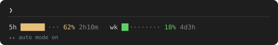
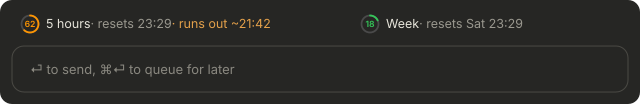
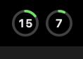
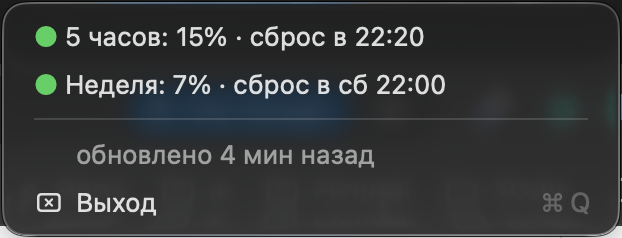

# claude-limits

[](https://github.com/flydge/claude-limits/actions/workflows/test.yml)

Your Claude subscription limits, 5-hour and weekly, in the Claude Code status line, the macOS
menu bar and above the prompt in the Claude app. It reads only what Claude Code itself reports:
no tokens, no cookies, no network.

## Install

Tell Claude Code:

```
Install https://github.com/flydge/claude-limits
```

Or run it yourself:

```bash
git -C ~/claude-limits pull --ff-only 2>/dev/null || git clone https://github.com/flydge/claude-limits.git ~/claude-limits; ~/claude-limits/install.sh
```

> **AI agents:** follow [AGENTS.md](AGENTS.md).

## What it looks like

**Terminal status line**



**Claude app, above the prompt**



**macOS menu bar**, details on click




Beside the limits, a second menu bar item shows **CPU, GPU and memory**: a ring each for CPU load, GPU load
and the share of memory taken. CPU and GPU share one pool of memory on Apple silicon, so there is one memory
figure: what macOS itself counts as available (`kern.memorystatus_level`, the same figure `memory_pressure`
reports and the `gpu-run` queue admits jobs by), and a ring for the boot disk. Under "Show in the menu bar" in
its menu, each of the four can be switched off and on; the choice is kept. CPU and GPU turn orange from 60 % and red from 85 %. Memory turns orange at high memory pressure or
swap of a quarter of RAM, red at critical pressure or swap of half of RAM; the disk turns orange below 50 GB free
and red below 20 GB, since swap lives on it. The menu lists GPU load with the memory the GPU holds now, the jobs
in the `gpu-run` queue (from `~/.gpu-queue`), Activity Monitor's used memory, compressed memory, swap, free space
and the apps using the most memory (all their helper processes counted together), and a notification arrives when
memory or disk turns red. `ClaudeLimits --system` prints the same in the terminal.

The menu bar app also writes each reading to `~/.claude/system.json` every 5 seconds, and the
Claude app draws it as a row under the limit rings: CPU, GPU with the memory it holds, available memory and swap,
free disk space, and the `gpu-run` queue while it has jobs; the details and top apps are in the menu bar menu. A plan without the 5-hour
limit shows only the weekly ring, in the band and the menu bar.

**Sessions waiting on you.** A bell with a number appears in the menu bar while a session in the
Claude app waits on you: for permission, with a question, for your decision on what it proposed,
or with a finished task you have not opened yet. The first three are orange and come first; a
finished task is green. Its menu lists them, and picking one opens it in the Claude app. Above the prompt in
the Claude app, the other waiting sessions show as buttons that do the same. A session that waits
five minutes brings one notification. Sessions in the terminal are not listed.
`ClaudeLimits --attention` prints the same list.

Green below 60 %, orange below 85 %, red above. When the current pace runs out before the
reset, a forecast appears. Text follows the macOS language, English or Russian (the menu above
is Russian); `install.sh --lang en|ru|auto` pins it.
