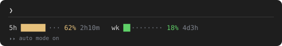
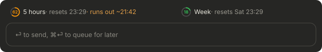
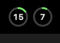
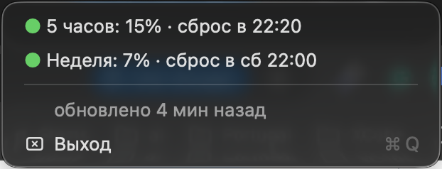

# claude-limits

[](https://github.com/flydge/claude-limits/actions/workflows/test.yml)

Your Claude subscription limits, 5-hour and weekly, in the Claude Code status line, the macOS
menu bar and above the prompt in the Claude app. It reads only what Claude Code itself reports:
no tokens, no cookies, no network.

## Install

Tell Claude Code:

```
Install https://github.com/flydge/claude-limits
```

Or run it yourself:

```bash
git -C ~/claude-limits pull --ff-only 2>/dev/null || git clone https://github.com/flydge/claude-limits.git ~/claude-limits; ~/claude-limits/install.sh
```

> **AI agents:** follow [AGENTS.md](AGENTS.md).

## What it looks like

**Terminal status line**



**Claude app, above the prompt**



**macOS menu bar**, details on click




Beside the limits, a second menu bar item shows **memory and disk**: a ring for the share of
RAM in use and one for the boot disk, each after a small chip or drive symbol. Memory turns
orange at high memory pressure or swap of a quarter of RAM, red at critical pressure or swap of
half of RAM; the disk turns orange below 50 GB free and red below 20 GB, since swap lives on it.
The menu lists compressed memory, swap, free space and the apps using the most memory (all their
helper processes counted together), and a notification arrives when either ring turns red.
`ClaudeLimits --system` prints the same in the terminal.

The menu bar app also writes each reading to `~/.claude/system.json` every 5 seconds, and the
Claude app draws it as a second row under the limit rings: memory used and swap, free disk space.
Press it for the details and the apps using the most memory.

**Sessions waiting on you.** A bell with a number appears in the menu bar while a session in the
Claude app waits on you: for permission, with a question, or with a finished task you have not
opened yet. Its menu lists them, and picking one opens it in the Claude app. Above the prompt in
the Claude app, the other waiting sessions show as buttons that do the same. A session that waits
five minutes brings one notification. Sessions in the terminal are not listed.
`ClaudeLimits --attention` prints the same list.

Green below 60 %, orange below 85 %, red above. When the current pace runs out before the
reset, a forecast appears. Text follows the macOS language, English or Russian (the menu above
is Russian); `install.sh --lang en|ru|auto` pins it.
